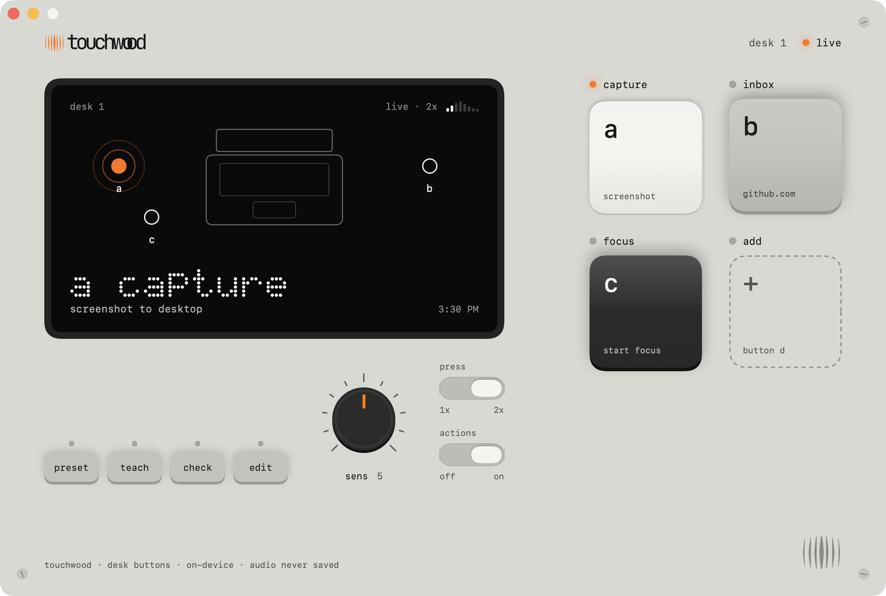
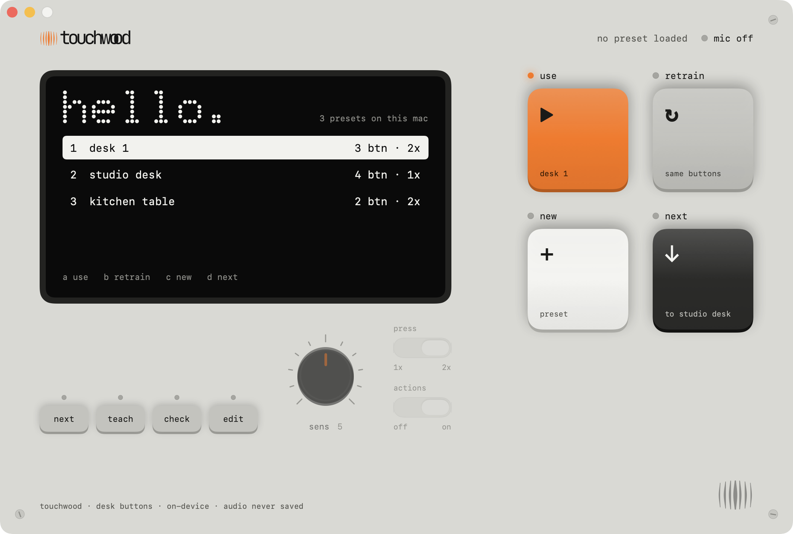
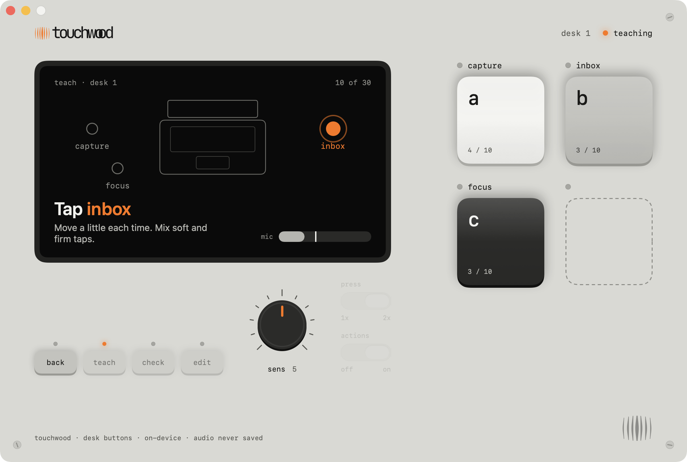
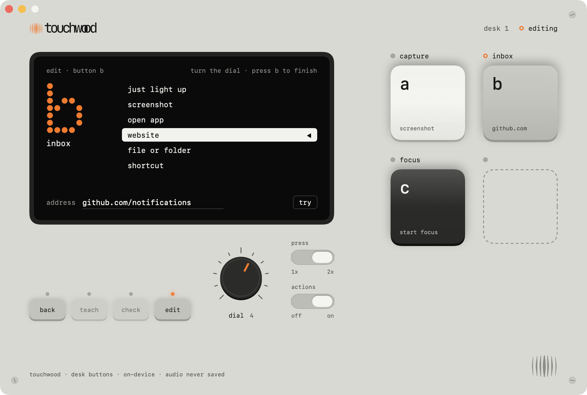

# Touchwood

Turn spots on your desk into buttons. Tap beside your laptop and Touchwood takes a screenshot, opens an app or a website, or runs a Shortcut. It listens through your Mac's built-in microphone and learns what each spot sounds like. Nothing leaves your Mac.



> [!WARNING]
> **Early version: the sound side is the part we're least sure of.** Touchwood can mix up two spots, miss soft taps, and now and then take an everyday sound for a press. How well it works depends a lot on your desk and your room. We're working on it, and recognition will get better with each version. Until then, don't put anything you can't undo on a button.

| Pick a preset | Teach your spots | Choose what a button does |
| --- | --- | --- |
|  |  |  |

## Install

There is no download yet; you build it from source. You need macOS 14 or later and Apple's Swift compiler (Xcode, or the Command Line Tools from `xcode-select --install`).

```sh
git clone https://github.com/theroofkashyap/touchwood.git
cd touchwood
sh build.sh
open build/Touchwood.app
```

Made for a MacBook's built-in microphone; select it as the input in System Settings → Sound before launching. Other microphones are untested.

## Privacy

Everything runs on your Mac and nothing is sent anywhere. The app never saves audio. A preset keeps 25 numbers describing each taught tap, never the sound itself, in `~/Library/Application Support/Touchwood/presets.json`, which stays on your Mac and is not part of this repository. Only the command-line two-spot test below saves short tap clips, into `taps/` in the folder you run it from.

## The app

The window is drawn as one device: a small black screen, four big keys, a row of function keys with LEDs, a dial and two slide switches. Lowercase labels, an orange LED for what is active. The logo and its mark (the grille, bottom right) come from `Resources/`.

- **The four big keys** are your desk buttons, a to d. A key's LED lights when its spot is pressed and blinks while it waits for the second tap of a double tap. On the welcome and done screens they are soft keys, labelled on the screen.
- **Function keys**: preset (back to the welcome screen), teach (retrain this preset), check, edit (names and positions). During setup the first one reads back.
- **Dial**: sensitivity, 0 to 10, saved per preset. 5 is the detector's usual 6× the room noise; higher hears softer taps. Drag it up or down. While choosing an action it steps through the six kinds instead.
- **Switches**: press with one tap or two, and actions off or on.

Every launch opens on the welcome screen with the microphone off. It lists your presets; click one or press **d next**, then **a use** (start listening), **b retrain** (teach the same buttons again for a room that sounds different today; names, positions and actions stay) or **c new**. It warns when a preset was taught with a different microphone. A first launch has one key, **start**. Setup runs:

1. **Edit.** Name the preset and up to four buttons, and drag each dot on the screen's desk drawing to where you will tap. Keys select a button; the empty key adds one. The drawing only names them: Touchwood never measures position, it learns what each spot sounds like.
2. **Teach.** Allow microphone access and stay quiet for three seconds. The screen shows the desk drawing with the spot to tap pulsing, and says "Tap left" in plain words. Tap once, 10 taps per button, the buttons in turn (left, right, left, right), so you can keep a rhythm without reading the screen; turn order spreads any drift in the room evenly over all buttons. Move a little each time and mix soft and firm taps. Each tap that counts lights its spot, rings the screen in orange and shows "Got it" with the next spot for 0.8 seconds; a second tap in that time is ignored. The mic meter has a line where a sound starts to count; turning **sens** moves it. A sound that comes close without crossing it gets "too soft". A tap unlike the others at that button is asked for again.
3. **Everyday noise.** For 15 seconds, type, click and set things down as usual. These sounds are kept as "not a button".
4. **Check.** Press 8 prompted buttons for real, with the chosen gesture, shown the same way on the desk drawing: correct, read as another button, or missed.
5. **Done.** The check result, how many everyday sounds would have pressed a button (each judged by a recognizer that never heard it), how far apart the buttons sound, and a note. **a save**, **b check again**, **c retrain**, **d discard**.

While teaching and checking, only the screen says where to tap: key LEDs light only when their spot counts, and the switches fade back. **back** returns to where setup started. On the live screen a press lights its key and its dot on the desk drawing, shows its name in dot-matrix type and runs its action. Click a key to choose what it does: the screen lists the six kinds (turn the dial or click one), with the details below and **try** to run it now; press the key again to finish. Deleting a preset is on the edit screen.

To change a taught preset, press **edit**. Renaming the preset or a button, dragging a dot or removing a button changes no button's sound, so **save** keeps the remaining buttons' teaching and returns to where you started. A removed button's taught taps go with it. An added button needs teaching, which for now means teaching every button again; **save** stays hidden until then.

**Actions:**

- **Screenshot**: every display to the Desktop, the main display to the clipboard, or an area you pick. macOS asks to allow Screen Recording for Touchwood the first time; without it, the capture shows only the desktop background. Each rebuild has a new ad-hoc signature, so macOS may ask again.
- **Open app**, **website** (https:// is added when left out) or **file or folder**.
- **Shortcut** from the Shortcuts app, which covers nearly anything else: music, focus modes, messages, home devices.

An action runs at most once a second per button, so a habit double tap in single-tap mode doesn't fire it twice. Actions run only on the live screen, never while editing, teaching or checking. A tap is refused as "not a button" when it is far from every button, or closer to an everyday sound than to any taught tap; it reads "?" when two buttons are nearly tied. Sounds more than 6 dB quieter than the softest taught tap are ignored.

Presets are saved in `~/Library/Application Support/Touchwood/presets.json`: names, positions, actions, sensitivity, and 25 numbers describing each taught tap and everyday sound, never audio. A setup saved by an earlier version becomes "Desk 1". Changing the audio input mid-setup returns to the saved preset.

## Command-line prototype

Requires Apple's Swift compiler (Xcode or Command Line Tools).

```sh
sh build.sh
./build/touchwood --self-test
./build/touchwood
```

Allow microphone access when macOS asks. Stay quiet during the first three seconds, then tap twice about 250 ms apart. Default mode prints events only. Ctrl-C stops listening. Restart after changing input devices.

To save a main-display screenshot on each detected double tap:

```sh
./build/touchwood --screenshots
```

PNG files go into `captures/` under the directory you launch from. macOS may require Screen Recording permission for the launching terminal. No screenshots are uploaded or sent to an agent.

## Two-spot test

Checks whether two spots on your desk sound different enough to become separate buttons, before any zone UI exists.

```sh
sh build.sh
./build/touchwood --record left right
```

Pick spots far apart, such as left and right of the laptop. Stay quiet for three seconds, then tap once wherever each prompt says, mixing soft and firm taps at every spot. Prompts come in random order, 15 per spot (`--taps N` changes that), so drift in the room never lines up with one spot. A second tap within 0.8 seconds is ignored. Each tap is saved as a 150 ms WAV clip in `taps/<spot>/`, which QuickTime plays; all input channels are kept. The analysis runs after the last tap, and `./build/touchwood --analyze` reruns it. Recording again adds to the same folders; delete `taps/` to start over. Clips never leave this Mac.

The analysis guesses each tap's spot from the average of all the other taps ("leave-one-out"). It compares sound shape with loudness removed: energy in 24 frequency bands from 150 Hz up, plus how fast the sound dies away. It prints the share guessed right, a table of mix-ups, and the same score from loudness alone. Over 90% means live zone guessing is worth building. If loudness alone does about as well, the verdict is "unclear": quiet taps carry more room noise, so tapping harder at one spot can fake a difference. Scores below chance mean no difference; leave-one-out dips under chance when spots are alike. The self-test checks this pipeline on synthetic taps only, not on a real desk.

## What it measures

Audio is reduced to approximately 5 ms RMS windows. A three-second startup estimates background level. Short bursts exceeding both a fixed minimum and six times the adaptive noise estimate become tap candidates. Two candidates 140–480 ms apart trigger an event, followed by a 1.5-second cooldown. Sustained bursts over 65 ms are rejected.

This is a baseline heuristic: typing, claps, music, or objects striking the desk can still trigger it. Soft taps may be missed. Synthetic tests cover timing and noise gating, not actual acoustic accuracy. Microphone access and screenshot capture need manual validation on the target Mac.

## Known limits

- **Recognition.** Spots are told apart by the shape of their sound alone, from one microphone channel; there is no way to measure position. Spots on the same surface close together sound alike, and a desk, a room or even the day's noise can change how well it works. Retrain when it starts missing.
- **Only while the window is open.** Touchwood listens on the live screen and stops when you close it; there is no menu bar or background mode yet.
- **No signed download.** The build is signed ad hoc on your Mac, so macOS may ask for microphone and Screen Recording access again after each rebuild.

Better recognition is the main work ahead. If Touchwood misreads your desk, an issue with your Mac model, what the desk is made of and what went wrong helps a lot.

## Contributing

Issues and pull requests are welcome. `sh build.sh && ./build/touchwood --self-test` runs the synthetic tests; they check the pipeline, not how well a real desk is recognized.

## License

[MIT](LICENSE)

References: [Holo](https://github.com/JustinGamer191/Holo), [ghost_pad experiment](https://github.com/RahulGautamSingh/ghost_pad), [Apple audio input](https://developer.apple.com/documentation/AVFAudio/AVAudioEngine/inputNode).
